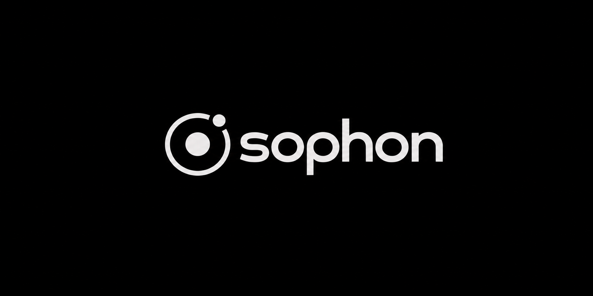

  

<h1 align="center">sophon</h1>

  Intelligent agents. One focused platform.

  <em>A minimal foundation for building with AI.</em>

---

## Overview

**Sophon** is an AI and agent platform designed to bring models, tools, and agent workflows into one cohesive experience.

Built around clarity and extensibility, Sophon aims to make intelligent systems easier to compose, operate, and evolve.

## Principles

- **Clarity** — a focused experience without unnecessary complexity.
- **Composability** — connect models, tools, and workflows.
- **Extensibility** — build toward new capabilities as the platform evolves.

## Project status

Sophon is currently in development. Features, architecture, and interfaces may change as the project progresses.

---

  Built with intent. Designed for intelligence.

