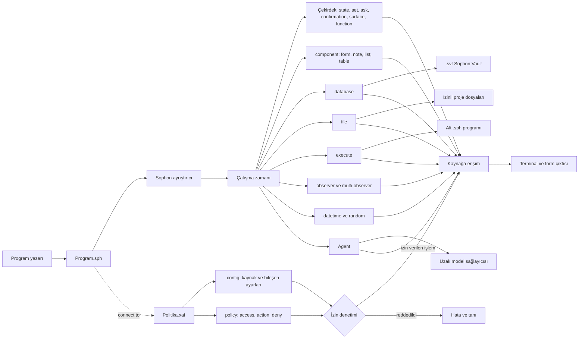
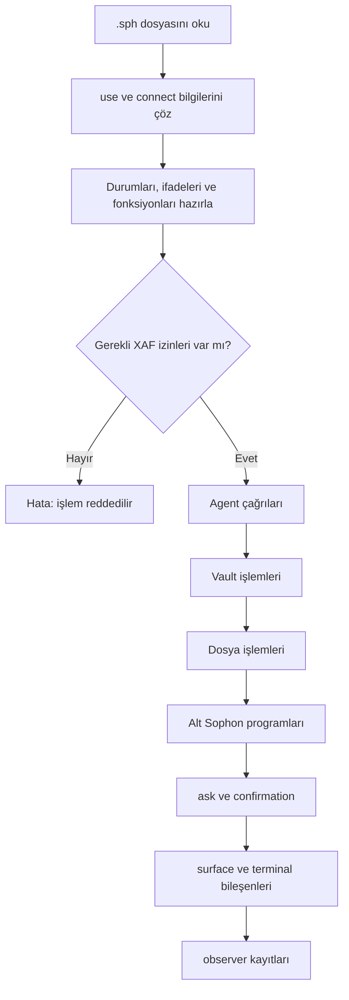
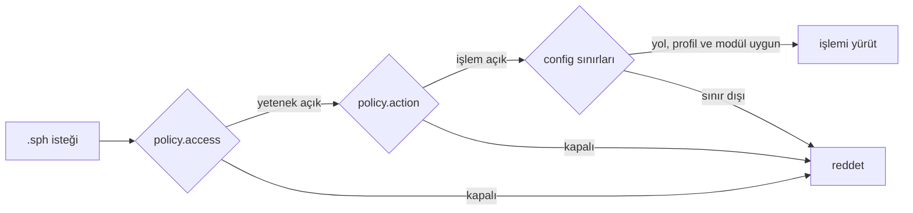

<p align="center">
  
</p>

<h1 align="center">Sophon</h1>

<p align="center"><strong>Politikayla sınırlandırılmış programlama dili ve çalışma zamanı</strong></p>

<p align="center">Bir programı yaz. Yetkilerini açıkça tanımla. Sophon çalışma zamanında yürüt.</p>

---

Sophon, `.sph` programlarını çalıştırır. Programın kullanabileceği kaynak ve işlemler `.xaf` politikasıyla belirlenir; kalıcı kayıtlar `.svt` Vault dosyalarında tutulur. Dil; durum, kullanıcı etkileşimi, dosya ve veri işlemleri, gözlem, terminal bileşenleri ve Agent çağrıları için tek bir sözdizimi sunar.

Bu README, ilk programdan bütün ana bileşenlere kadar kısa bir yol haritasıdır. Her sözdizimi kuralının ve hata kodunun tam açıklaması [SYNTAX.md](SYNTAX.md), XAF politikalarının tam şeması [XAF_V2_SCHEMA.md](XAF_V2_SCHEMA.md) içindedir.

## Mimari: üç dosya, tek çalışma akışı

| Dosya | Rol | İçerik |
|---|---|---|
| `.sph` | Program | Durumlar, ifadeler, kullanıcı etkileşimi ve modül çağrıları |
| `.xaf` | Kontrol ve politika | İzinler, Agent ayarları, dosya yolu sınırları ve bileşen profilleri |
| `.svt` | Sophon Vault | `database` modülünün kullandığı kayıtlar |



`.sph` yürütülür. `.xaf` doğrudan çalıştırılmaz; `connect to dosya.xaf` ile programa bağlanır. Bağlı XAF yoksa Sophon ilk çalıştırmada bir tane üretebilir. Mevcut elle yazılmış XAF dosyası korunur. Üretilen politikayı dağıtımdan önce kontrol edin ve gereken en az yetkiyle sınırlandırın.

## 1. Kur ve ilk programını çalıştır

Repo içindeki launcher için Python 3 gerekir; ayrı paket kurulumu gerekmez:

```bash
git clone https://github.com/ardakooza/sophon.git
cd sophon
./sophon --version
./sophon --help
```

`hello.sph` adında bir dosya oluştur:

```sph
connect to hello.xaf
use { random }

state name = "Sophon"
state greeting = "Merhaba, {name}!"
state dice = random.integer(1, 6)

state result_text = "Zar sonucu: {dice}"

surface {
    greeting
    result_text
}
```

Çalıştır:

```bash
./sophon run hello.sph
```

İlk çalıştırmada `hello.xaf` oluşabilir. Programın dosyaları şöyle görünür:

```text
proje/
├── hello.sph       # yürütülen program
├── hello.xaf       # programın izin ve bileşen ayarları
└── data.svt        # gerekirse: Vault kayıtları
```

`state` değerleri metin, tam sayı, ondalık sayı, boolean, null, liste veya nesne olabilir. Tipi başlangıç değerinden çıkartabilir ya da `state age: integer = 18` biçiminde belirtebilirsin. Metin içine `{state_adi}` yazarak değer ekleyebilirsin. Sayısal ifadelerde `+ - * / ^`, parantez ve `sqrt(...)` desteklenir. `set name = "Ada"` önceden tanımlanmış bir durumu günceller ve türünü korur.

## 2. Programın çalışma sırası

Sophon en üst düzey deyimleri ayrıştırır; çalışma zamanı etkileri belirli aşamalarda yürütür:



Üst düzey aşama sırası `agents → databases → file → execute → ask → surface → observers` şeklindedir. Bu yüzden üst düzey `surface`, kaynak dosyada bir `ask` satırından önce dursa da sorular önce alınır. `form` içindeki adımlar ise tek tek, yazıldıkları sırayla yürür; form içinde bir `surface` kullanmadan önce gösterilecek durumu oluştur.

## 3. Dil bileşenleri

### Temel dil

Bu deyimler için `use` gerekmez:

| Deyim | Ne yapar |
|---|---|
| `connect` | Bir XAF politikasına bağlanır |
| `state`, `set` | Tekil durumu oluşturur veya günceller |
| `multi-state` | Alanları adlandırılmış bir grup durum tutar |
| `surface` | Metin ve durumları terminale yazar |
| `ask`, `multi-ask` | Kullanıcıdan bir veya birden çok değer alır |
| `confirmation`, `multi-confirmation` | Seçenek sunar; tekli veya çoklu yanıt alır |
| `function` | Tipli parametrelerle yerel fonksiyon tanımlar |

`multi-state`, `multi-ask`, `multi-confirmation` ve `multi-observer` için XAF'ta hem `config.multi` içinde ilgili ad hem de `policy.access.multi` izni gerekir. Bunları sıradan tekil `state`/`ask` özellikleriyle karıştırma.

Bir gruplu durum şu şekilde bildirilir ve alanına `person.name` biçiminde erişilir:

```sph
multi-state {
    id = "person"
    state {
        name = "Ada"
        age = 31
    }
}

state greeting = "Merhaba, {person.name}"
```

### Modüller

Modül kullanmadan önce `use { ... }` ile içe aktar. Gereken izinler modüle göre değişir. `datetime` ve `random` için modül izni gerekmez; ancak her `.sph` programı yine de bir XAF'a `connect` ile bağlanmalıdır.

| Modül | Sağladığı özellikler | XAF gereksinimi |
|---|---|---|
| `datetime` | Yerel tarih ve saat: `date`, `time`, alanları | Hayır; yerel standart kütüphane |
| `random` | `integer`, `float`, `boolean`, `choice` | Hayır; yerel standart kütüphane |
| `database` | `.svt` Vault kayıtlarını okuma/yazma/değiştirme/silme | `access.database` ve ilgili eylem izni |
| `observer`, `multi-observer` | Durumları veya başka `.sph` kaynaklarını izleme | Observer profili, kaynak izni ve okuma izni |
| `component` | Terminal kutularını bir araya getirme | Gruplu `component` için `access.component` |
| `file` | Proje içi dosya ve klasör işlemleri | İzinli yollar ve ayrıntılı dosya sistemi izinleri |
| `execute` | İzin listesinde bulunan başka `.sph` programını çalıştırma | `access.execute` ve XAF dosya izin listesi |
| `agent` | Yapılandırılmış Agent'a mesaj veya görev gönderme | Agent, politika ve sağlayıcı yapılandırması |

`math`, `system`/`sys` ve `multi-agent` bu sürümde uygulanmış modüller değildir. `random` Python'ın sıradan sözde rastgele üretecini kullanır; parola, token veya güvenlik anahtarı üretmek için uygun değildir.

### Fonksiyonlar

Fonksiyonlar tipli parametre, varsayılan veya isteğe bağlı değer ve tekli ya da çoklu çıktı destekler:

```sph
function {
    id = "double"
    input { value: integer }
    execute {
        state result = value * 2
    }
    output: integer = result
}

state answer = double(21)
surface { answer }
```

Fonksiyonların yerel durumları çağrı dışına sızmaz. Fonksiyon içindeki `set`, parametreleri veya daha önce tanımlanmış yerel durumları günceller; dış durumlar salt okunurdur. Bu sürümde fonksiyon ifadeleri program durumları ayrıştırılırken değerlendirilir; sonradan alınan kullanıcı yanıtı veya Agent sonucu fonksiyon girdisi olarak kullanılamaz.

### Kullanıcı arayüzü ve terminal bileşenleri

`component` bir veya daha çok kutuyu gruplar. `note` metin, `list` öğeler, `table` satır ve sütunlar gösterir. `form`, `ask`, `confirmation` ve `surface` adımlarını tek bir etkileşimli akışta birleştirir.

```sph
use { component }

component {
    id = "summary"
    note { title = "Durum" text = "Hazır" }
    list { title = "Özellikler" item = "Politika" item = "Vault" }
    table { title = "Kayıt" row "ad" "Ada" row "yas" 31 }
}
```

## 4. XAF: izinler nasıl işler?

XAF iki tür bilgi taşır:

1. `config` bileşen ayarlarını ve kaynak sınırlarını tanımlar.
2. `policy` programa hangi yetenek ve eylemlerin verildiğini tanımlar.

Bir yetenek izni, o yeteneğin her işlemini otomatik olarak açmaz. Örneğin dosya okuma için `file-system` erişiminin yanında izinli proje yolu, dosya okuma ayarı ve `action.read` gerekir. Olmayan veya `false` olan izin reddedilir.



Örnek XAF iskeleti:

```xaf
config {
    default-policy = 1001
    multi { multi-state multi-ask multi-confirmation multi-observer }
    file-system {
        allowed_path { "data" "output" }
        forbidden_path { "data/private" }
        action {
            file { create read modify copy move delete }
            folder { create read modify copy move delete zip-unzip }
        }
    }
}

policy {
    id = 1001
    access { database file-system execute observer component }
    action {
        read = true
        write = true
        modify = true
        create = true
        remove = false
    }
}
```

XAF v2'de `access` yetenekleri ile `action` izinleri birbirinden ayrıdır. `deny`, kalıtılan izinleri iptal edebilir ve alt politika grant'lerinden önce gelir. Dosya yolları proje kökünün dışına çıkamaz; `forbidden_path`, `allowed_path` içinde olsa bile reddedilir. Yetki tanımlarken gerekmeyen erişimleri açma.

## 5. Veri ve yan etki bileşenleri

### Sophon Vault (`.svt`)

`.svt`, `vault` ve `record` bloklarından oluşan metin tabanlı yerel kayıt dosyasıdır:

```svt
vault {
    record {
        id = 1
        name = "Ada"
        age = 31
        tags = ["matematik" "bilim"]
    }
}
```

SPH programı Vault'ı bir takma adla kullanır:

```sph
use { database }

database users {
    connect = data/users.svt
    read { id = 1 state = selected_user }
}
```

Her kaydın benzersiz `id` alanı olmalıdır. Vault yolu proje içinde çözülür; güncellemeler atomik kaydedilir. Erişim ve `read`/`write`/`modify`/`remove` eylemleri XAF ile denetlenir.

### Dosyalar ve alt programlar

`file` modülü dosya oluşturma, okuma, yazma, ekleme, listeleme, kopyalama, taşıma, silme ve arşivleme işlemlerini yapar. Tüm yollar proje kökü ve `config.file-system` sınırları içinde kalır. `execute` başka bir `.sph` dosyasını kendi politikasıyla çalıştırabilir. Kayıtlı Sophon komutları bu sürümde bulunmadığından `command` kullanılamaz.

### Observer

`observer`, tek bir kaynakta durum veya alanları; `multi-observer` birden fazla tanımı izler. Kaynak `self` (mevcut program) ya da başka bir `.sph` dosyası olabilir. XAF'ta eşleşen sayısal Observer profili, kaynak sınıfı izni ve okuma izni gerekir. `self-observation` özelliği ayrıca XAF'ta etkinleştirilir.

## 6. Agent ve sandbox sınırları

Agent ayarları XAF'ta tanımlanır: sayısal Agent kimliği, politika kimliği, sağlayıcı/model, API anahtarının ortam değişkeni adı, girdi/çıktı token limitleri ve zaman aşımı. Gizli anahtarı XAF'a veya kaynak dosyaya yazma; anahtarı belirtilen ortam değişkeninde tut.

SPH içinden Agent'a bağlanıp mesaj göndermenin biçimi:

```sph
use { agent }
agent connect { id = 1001 }
```

Agent isteği ayrıca `access.agent`, `action.read` ve Agent kaydında `permission.execute = true` gerektirir. Agent kullanımı sağlayıcıya ağ isteği gönderebilir ve yanıt maliyeti doğurabilir.

`security.container = true` seçeneği Linux user/mount/PID/UTS/IPC/network namespace ve `chroot` tabanlı yalıtımı kullanır. Bu yalıtım yalnızca Agent sağlayıcı isteği sürecine uygulanır; genel amaçlı kod veya araç çalıştırma sandbox'ı değildir. Gerekli Linux özellikleri yoksa çalışma zamanı güvenli olmayan moda düşmek yerine isteği `A035` ile reddeder. Teknik ayrıntı ve bilinen sınırlar [SANDBOX.md](SANDBOX.md) içindedir.

## 7. Şimdiki kapsam ve sınırlar

| Özellik | Durum |
|---|---|
| Durum, ifadeler, fonksiyonlar, girdi/çıktı ve modüller | Uygulandı; ayrıntılar SYNTAX referansında |
| Koşullu dallanma (`resolve / when / otherwise`) | Tasarım aşamasında; henüz çalıştırılamaz |
| Mantıksal operatörler ve karşılaştırmalar | Control Flow ile birlikte henüz uygulanmadı |
| Multi-Agent / Agent takımları | Tasarım/yol haritası; çalıştırılabilir modül değil |
| `math`, `system`/`sys` | Henüz uygulanmadı |
| `execute command` | Komut kayıt defteri boş; bu sürümde kullanılamaz |
| Agent sandbox | Linux'a bağlı; yalnızca sağlayıcı isteği sürecini yalıtır |

Yani bu sürümde `if/else` yazılamaz. Tasarım belgeleri gelecek sözdizimini anlatır, çalışan dil özelliği olarak değerlendirilmemelidir.

## 8. Komutlar ve proje belgeleri

```bash
./sophon --help
./sophon --version
./sophon run program.sph
./sophon agent -f program.sph -m "Selam."
./sophon agent -f program.sph -t "Bu görevi yap."

python3 test_regressions.py
python3 -m unittest -v test_language_integration.py
python3 check_docs.py
python3 run_audit_corpus.py
```

Test ve denetim komutları isteğe bağlı doğrulama araçlarıdır. `run_audit_corpus.py` oluşturduğu denetim verilerini geçici bir klasörde tutar.

| Dosya | İçerik |
|---|---|
| [SYNTAX.md](SYNTAX.md) | Güncel dil sözdizimi, modüller, CLI ve tanı kataloğu |
| [XAF_V2_SCHEMA.md](XAF_V2_SCHEMA.md) | Güncel XAF yapılandırma ve politika şeması |
| [SANDBOX.md](SANDBOX.md) | Agent sandbox mimarisi ve sınırları |
| [FUNCTIONS_DESIGN.md](FUNCTIONS_DESIGN.md) | Fonksiyon sözdizimi ve davranışı |
| [CONTROL_FLOW_DESIGN.md](CONTROL_FLOW_DESIGN.md) | Henüz uygulanmayan koşul tasarımı |
| [SPH_XAF_COMPLETE_REFERENCE.md](SPH_XAF_COMPLETE_REFERENCE.md) | Geniş birleşik referans; tasarım bölümlerinin uygulandığını varsayma |

## Proje durumu

Sophon geliştirme aşamasındadır. Parser'ın kabul ettiği güncel davranış için [SYNTAX.md](SYNTAX.md) ve [sophon.py](sophon.py) esas alınır; XAF için [XAF_V2_SCHEMA.md](XAF_V2_SCHEMA.md) geçerlidir. Öneri veya hata bildiriminde küçük bir `.sph`/`.xaf` örneği ve beklenen-gerçekleşen davranışı paylaşmak yeterlidir.
